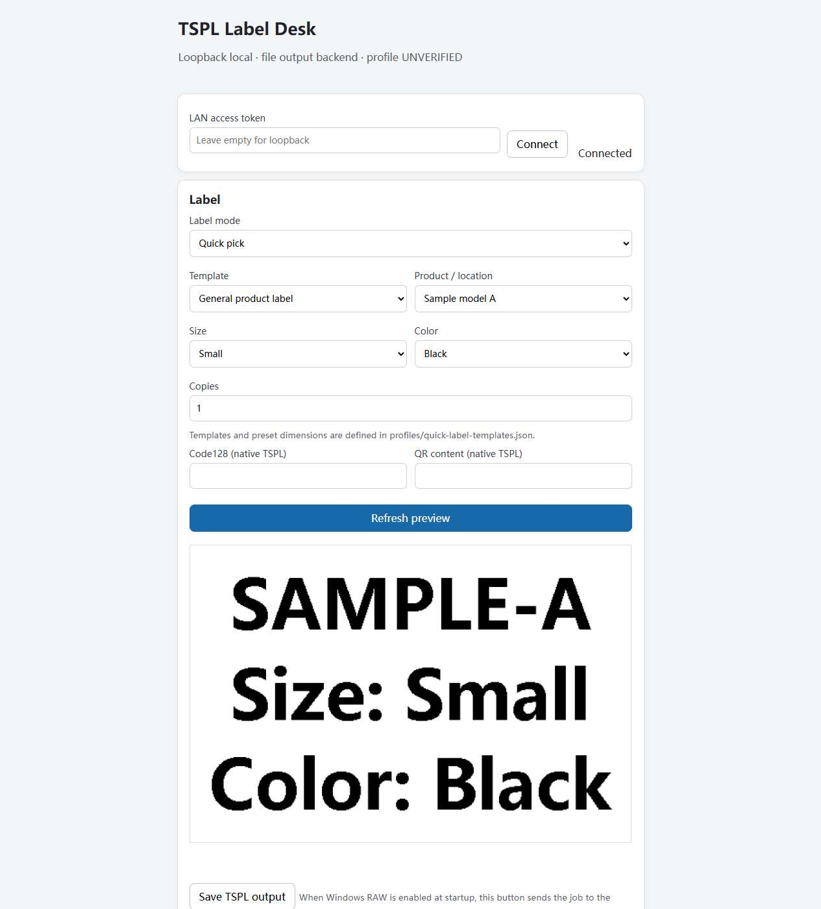

# TSPL Label Desk

一个面向 Windows 本地使用的小标签打印台，用于快速组合、预览、标定并输出自定义 TSPL 标签。

**快速点选、实时预览、纸张标定。** 选择商品或仓储位置并点选预设维度，也可切换到自由文本；预览内容与输出内容一致。

## Windows 快速开始

1. 请自行安装 Python 3.10 或更新版本。
2. 双击 `setup.cmd`。脚本仅在项目目录内创建 `.venv` 并安装项目声明的 Python 包。
3. 双击 `start.cmd`，然后打开 [http://127.0.0.1:8630](http://127.0.0.1:8630)。

默认输出为本地 TSPL 文件，保存在 `.runtime-data/outbox`，不会连接打印机。Windows RAW 需启动时显式指定 `--backend windows`，并在打印配置中填写队列。局域网默认关闭；仅使用 `--lan --host 0.0.0.0` 显式开启，并输入控制台显示的临时令牌。

## 打印机验证状态

通用示例 Profile 当前为 **UNVERIFIED**。203 DPI 软件输出与脱敏历史基线比较；300 DPI 仅经过软件测试。没有实物输出及尺寸测量证据时，不宣称任何打印机/固件组合兼容。软件测试不能替代真机测试。

## 快速标签与配置

内置的是通用商品和仓储示例。可编辑 `profiles/quick-label-templates.json` 定义每个模板的 1–3 个预设维度；可在“型号管理”中维护可选商品。用户配置保存在本地 `.runtime-data`，不属于源码包。Profile 中的标定值为唯一权威来源，`paper.json` 是兼容镜像。

## 详细文档

- [Windows 运行、停止和诊断](docs/windows.md)
- [兼容性测试与证据](docs/compatibility.md)
- [兼容性状态表](docs/compatibility-matrix.md)
- [依赖许可证清单](docs/licenses.md)

## 开发

运行 `python -m pytest -q`。前端是静态 HTML/CSS/JavaScript，无需 Node 构建。`setup.cmd` 不安装 Python 或系统组件，也不修改全局 Python 包。

## 许可证

MIT，详见 [LICENSE](LICENSE) 和[依赖许可证清单](docs/licenses.md)。
